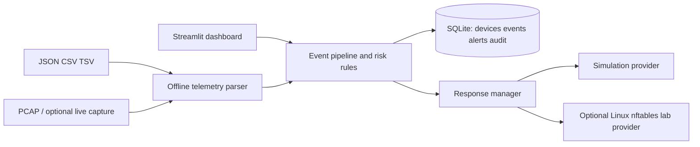

# CyberShield Mesh

CyberShield Mesh is a defensive network telemetry and response teaching application using Streamlit, SQLite, and transparent rules. It supports structured event imports and offline PCAP analysis, event scoring, alerting, audit history, and provider-based response. The default provider is simulation: it records an isolation decision but does not block traffic.

## Architecture



## Structure

```text
app.py
cybershield/config.py       Environment configuration
cybershield/database.py     SQLite schema and persistence
cybershield/engine.py       Ingest, score, alert, and response workflow
cybershield/threat_detector.py Transparent scoring rules
cybershield/telemetry.py    JSON/CSV/TSV, PCAP, optional live capture
cybershield/enforcement.py  Simulation and opt-in Linux nftables providers
tests/                      Automated tests
```

## Install and run on macOS

Python 3.10+ is recommended. From the project directory:

```bash
python3 -m venv .venv
source .venv/bin/activate
python -m pip install --upgrade pip
pip install -r requirements.txt
cp .env.example .env
python -m pytest -v
streamlit run app.py
```

Open `http://localhost:8501`. The dashboard binds to localhost by default. The convenience launcher `./run_mac.command` creates the environment, installs dependencies, runs tests, and launches Streamlit. No administrator access is needed for the dashboard or simulated demonstrations.

## Demonstration

1. Start the app; the four example devices are initialized if the database is empty.
2. In the sidebar, choose **Simulate port scan**. The event receives a rule-based score and creates an alert. With the default threshold, the source enters **simulated quarantine**.
3. Open **Events & Alerts** to inspect evidence and history.
4. In **Device Controls**, use the release button and confirm the audit history in **Audit Log**.
5. Use **Submit Event** for user-supplied metadata. These are claims supplied to the detector, not independently observed sensor facts.

A scan can also be demonstrated safely as metadata without generating attack traffic:

```bash
python -c 'from cybershield.engine import process_event; print(process_event({"src_ip":"192.168.10.40","dst_ip":"192.168.10.30","event_type":"port_scan","unique_ports":48,"evidence":"synthetic demonstration input"}))'
```

## Telemetry and detection

**Offline analysis:** Upload `.json`, `.csv`, `.tsv`, `.pcap`, or `.pcapng` under **Offline Analysis**. Structured events require a source address, with optional destination address, ports, protocol, timestamp, and event type. Example JSON:

```json
{"events":[{"src_ip":"192.168.10.40","dst_ip":"192.168.10.30","src_port":53000,"dst_port":22,"protocol":"TCP","timestamp":"2026-10-20T10:00:00Z"}]}
```

The parser caps uploads at 20 MiB and 250,000 records/packets. PCAP support extracts addresses, ports, protocol, and packet timestamps. The batch analyzer flags broad destination-port diversity and repeated connection records as suspicious patterns. Those are inferences from packet metadata. Passive packet metadata alone does not establish failed TCP connections or authentication attempts.

Rules and windows can be set in the sidebar for the current session or through `CYBERSHIELD_PORT_SCAN_PORTS`, `CYBERSHIELD_FAILED_ATTEMPTS`, `CYBERSHIELD_CONNECTIONS_PER_MINUTE`, and `CYBERSHIELD_DETECTION_WINDOW_SECONDS`. Defaults are 20 unique destination ports, 10 explicitly reported failed attempts, 120 connections/minute, and a 60 second window. Named event types add: port scan 85, authentication failures 65, traffic spike 70. Additive rules are +35, +30, and +25; scores cap at 100. Severity is low (0–39), medium (40–69), high (70–84), critical (85–100). Alert cutoff is 40; response cutoff defaults to 75 and can be changed with `CYBERSHIELD_RISK_THRESHOLD` or in the dashboard. Failed-attempt scores only apply when such telemetry is explicitly supplied by a reliable source.

## Live monitoring

Live capture is optional and disabled by default. Install Scapy (included in requirements), set `CYBERSHIELD_LIVE_CAPTURE=true`, restart the app, then choose an interface in **Offline Analysis**. Scapy/OS permissions vary by macOS version and interface; capture may require elevated packet-capture privileges. If unavailable, offline analysis and the dashboard continue to work. Capturing does not enforce blocking.

## Quarantine and enforcement

The terms have distinct meanings:

- **Detected:** rules identify a suspicious event.
- **Simulated quarantine:** default provider records the decision and changes the app's device status. No network restriction is applied; verification is false.
- **Enforced quarantine:** only a successful, verified provider result is labeled enforced.

The optional nftables provider is Linux-only and off by default. It is intended for a disposable, isolated lab host, not for a Mac or a production network. Set `CYBERSHIELD_ENFORCEMENT=nftables` only after reviewing `cybershield/enforcement.py`, ensuring `nft` is installed, and testing with a disposable IPv4 endpoint. It creates a dedicated CyberShield-owned `inet` table/chain with an accept policy and narrowly scoped source-address drop rules; it does not flush rules or change global defaults. Loopback, unspecified, multicast, link-local, and IPv6 targets are rejected. Verification checks the owned chain after each operation. Cleanup removes only a matching CyberShield-managed rule. Use **Release / restore online** to remove a rule and verify removal. Do not test on the management device or an essential service endpoint. nftables does not provide a switch/router isolation policy and may not stop traffic forwarded through another device.

The dashboard is unauthenticated. Keep it on localhost or a trusted isolated lab. Do not expose it publicly without adding authentication, TLS, and access controls. A cloud deployment cannot see a home or campus LAN unless a properly secured sensor sends telemetry to it; do not expose a sensor or dashboard directly to the public internet.

## Configuration and deployment

Copy `.env.example` and export the variables in your shell (Streamlit does not automatically load `.env` without an additional package):

- `CYBERSHIELD_DB_PATH`: SQLite file path; default `data/cybershield.db`, initialized automatically.
- `CYBERSHIELD_RISK_THRESHOLD`: automatic response threshold.
- `CYBERSHIELD_MAX_UPLOAD_BYTES`: UI upload limit (default 20 MiB).
- `CYBERSHIELD_LIVE_CAPTURE`: opt-in live capture (`true`/`false`).
- `CYBERSHIELD_ENFORCEMENT`: `simulation` by default, or explicit Linux lab `nftables`.

Container deployment:

```bash
docker build -t cybershield-mesh .
docker run --rm -p 127.0.0.1:8501:8501 -v cybershield-data:/data cybershield-mesh
```

The image includes a Streamlit health check and persists SQLite under `/data`. The dashboard can process uploaded/offline telemetry in a container. Live capture and enforcement require appropriate sensor placement, OS support, privileges, and deliberate network design; they are not enabled by the container setup.

## Computer Networks concepts

The project uses IP addressing, TCP/UDP ports, transport protocol metadata, connection-rate windows, port diversity, passive packet observation, and the distinction between monitoring-plane evidence and enforcement-plane control. A source contacting many destination ports may indicate scanning, but it is a heuristic and needs context.

## Tests and troubleshooting

```bash
python -m pytest -v
```

For `ModuleNotFoundError`, activate `.venv` and reinstall `requirements.txt`. If PCAP reports Scapy missing, install with `python -m pip install scapy`. If live capture is denied or no interfaces appear, use offline PCAP/event import; do not run the whole dashboard as root. nftables is unsupported on macOS and remains disabled unless explicitly configured on Linux. Use a fresh `CYBERSHIELD_DB_PATH` for an isolated demo. SQLite schema initialization runs at startup and does not require a pre-existing database.

## Limitations

This is an educational prototype, not a production IDS/IPS. Rules are simple and can generate false positives/negatives. A host packet capture sees only traffic visible at its interface. Database device inventory is not authoritative identity. nftables support is narrowly scoped to an isolated Linux lab; macOS host firewall cannot isolate another LAN device. Managed-switch, router, and wireless-controller adapters are future integrations. No authentication or multi-user authorization is included.

## Teammate sharing

See [DEPLOY.md](DEPLOY.md) for exact Streamlit Community Cloud steps and a same-Wi-Fi classroom option. A hosted instance is a shared, unauthenticated demo with temporary SQLite storage. Use synthetic records only; it cannot monitor a remote LAN, and the default quarantine provider does not block traffic.

## Additional project features

- **Analytics & Map:** risk-over-time chart, evidence-source chart, event type breakdown, and source/destination communication paths derived from stored events.
- **Alert triage:** acknowledge or resolve an alert; every status change is written to the audit log.
- **Deduplication window:** repeated identical inputs are suppressed for 60 seconds to reduce duplicate alerts while allowing later demonstrations to create a fresh event.
- **Continuous integration:** GitHub Actions runs the test suite on Python 3.11 and 3.12 for pushes and pull requests.
- **Presentation theme:** `.streamlit/config.toml` gives the dashboard a consistent security-themed dark palette.
